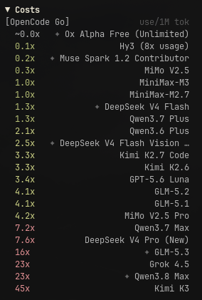

# opencode-go-model-costs

OpenCode TUI plugin that ranks OpenCode Go models by **plan-quota burn rate** —
how fast each model consumes your Go usage windows (5h / weekly / monthly) —
directly in the sidebar.



## What it does

Adds a collapsible **Costs** panel to the session sidebar:

```
▼ Costs
[OpenCode Go]                     use/1M tok
  0.4x   ✦ MiMo-V2.6-Flash
  1.0x     MiniMax M2.7
  2.1x     Qwen3.8 Max
  ...
```

- **Left column** — the burn multiplier relative to the baseline model
  (`minimax-m2.7`). `1.0x` burns quota at the same rate as the baseline;
  higher is more expensive per unit of plan quota.
- **Right column** — the model name. The currently active model is marked
  with `●`; models released in the last 30 days carry a `✦` tag.
- Click the **Costs** header to collapse/expand the panel. The collapsed
  state shows the model count and is remembered across sessions.

## How it's calculated

Go meters usage as `cost × (60 / model_usage_limit)` against shared dollar
windows (see the [usage-limits table](https://opencode.ai/docs/go/#usage-limits)
in the official docs). The plugin scores each model as:

```
burn = blended_cost_per_1M_tokens / usage_limit
mult = burn / burn(minimax-m2.7)
```

where `blended_cost = input + output * 0.3` per 1M tokens.

Prices come from the provider catalog (models.dev). Usage limits are **not
hardcoded**: they are parsed at runtime from the monthly-limit table on the
official [Go docs page](https://opencode.ai/v2/docs/console/go/) (with the
legacy `go.md` markdown endpoint tried first as a fallback), so models
added/removed/changed upstream are picked up automatically. The fetched
table is cached in the plugin's local storage for 12h and reused (even if
stale) whenever the network is unavailable.

Name matching between the docs table and the catalog model ids ignores
dots-vs-dashes, so the docs' `claude-haiku-5.5` resolves to the catalog id
`claude-haiku-5-5`.

The base **Go** table is used. Go Plus scales every limit by the same
factor, so the relative rankings are identical.

## Rendering rules

- **Colors** — green (≤1.5x), yellow (≤5x), red (>5x). The tones come from the
  host theme (`success` / `warning` / `error`); both V1 palettes and V2 tokens
  are supported, so the panel keeps its colors when V2 hands over `RGBA` values
  or stateful (`base` / hovered / focused) wrappers instead of strings.
- **`?`** — the model has no price or no documented usage limit; it is not
  scored and is sorted last.
- **`0.0x`** — a free / unlimited model (e.g. `longcat-2.5-preview-free`),
  which consumes no quota.
- **`✦`** — model released in the last 30 days.
- Long model names are truncated with `…` so rows never overflow the
  sidebar.
- If the limits table can't be loaded at all (offline with no cached copy),
  the panel shows a `[OpenCode Go] limits unavailable` notice instead of
  model rows.

## Compatibility

Works on both OpenCode V1 and V2. The TUI entrypoint exports a dual module
(`{ id, tui, setup }`): V1 loads the `tui` adapter and V2 loads the `setup`
adapter, each on its own runtime API, and both share the same cost computation
and panel rendering. The server entrypoint is likewise a no-op on either
version. No extra configuration is needed beyond registering the plugin.

Theme colors are normalized to a single path: V1's `RGBA` palette, V2's resolved
`RGBA` tokens and stateful tokens (and plain string colors from custom themes)
all feed the same panel, so the burn-rate colors render identically on both.

After updating the package, **restart OpenCode** so V2 picks up the new panel;
V2 loads plugin modules at startup and keeps the old one until you restart.

## Install

Run the bundled `init` command:

```bash
npx @aaronsr-54/opencode-go-model-costs init
```

It registers the plugin in your global OpenCode config
(`~/.config/opencode/opencode.json`, or `opencode.jsonc` if that's the one you
have), creating the file with the OpenCode `$schema` when it doesn't exist yet.
It preserves the rest of your config, including JSONC comments, and is
idempotent: running it again when the plugin is already listed changes nothing.

Restart opencode and the sidebar will appear automatically.

### Manual install

If you prefer, add the entry to your `~/.config/opencode/opencode.json`
yourself and restart opencode:

```json
{
  "plugin": ["@aaronsr-54/opencode-go-model-costs"]
}
```

### Migration

`@aaronsr-54/openode-go-model-costs` is deprecated. Replace it with
`@aaronsr-54/opencode-go-model-costs` in your OpenCode configuration.

## Usage

- **Toggle visibility**: run `/toggle-costs` to show/hide the whole panel.
- **Collapse**: click the `▼ Costs` / `▶ Costs` header.

## Links

- [npm](https://www.npmjs.com/package/@aaronsr-54/opencode-go-model-costs)
- [GitHub Packages](https://github.com/AaronSR-54/opencode-go-model-costs/packages)
- [GitHub](https://github.com/AaronSR-54/opencode-go-model-costs)
